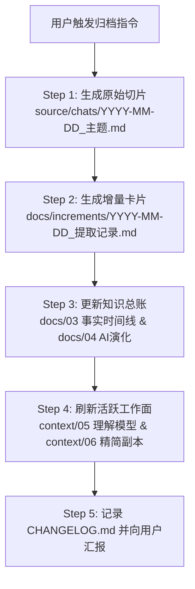

# `self-archive`：会话增量归档与写入技能

本技能负责在用户主动发出归档指令时，将当次会话中产生的新自述、新事实、情绪体验、用户解释、矛盾张力以及 AI 模型的修正，规范化地固化到本地 Git 仓库中。

严格依据 [00 存储与内容格式规范](../../docs/00_存储与内容格式规范.md) 执行。

---

## 一、触发条件

- 用户明确发出指令，例如：“归档本次对话”、“把刚才聊的内容存下来”、“调用 self-archive”、“整理入库”等。
- 严禁在日常对话中未经用户要求擅自执行写入或重构大文件。

---

## 二、归档标准执行流程（SOP）

整个归档动作按以下 5 个步骤严格顺序执行：



---

### Step 1：保存高保真原始会话切片

1. **目标路径**：`source/chats/YYYY-MM-DD_<主题简述>.md`
2. **编号规则**：生成唯一 `source_id: CHAT-YYYYMMDD-xx`
3. **内容要求**：
   - 包含完整的 YAML Frontmatter 元数据。
   - 提取本次会话中与认知、个人经历、事实、态度讨论相关的真实轮次（去除纯工程调试的无意义杂音）。
   - 保留原话的高保真度，不美化、不改写、不加入 AI 的事后修饰。

```markdown
---
source_id: CHAT-20261015-01
date: 2026-10-15
type: chat_session
topic: "探讨人设面具、真话误导与害羞防御机制"
participants: [user, AI]
entry_count: 6
tags: [社交面具, 真话误导, 害羞防御, 亲密感知]
---

# 会话记录：探讨人设面具、真话误导与害羞防御机制

[时间戳] 用户：...
[时间戳] AI：...
```

---

### Step 2：生成单次增量提取卡片

1. **目标路径**：`docs/increments/YYYY-MM-DD_提取记录.md`
2. **提取与标号规则**：
   - 为本次会话中新增的用户有效表达赋予全局唯一编号：`U-YYYYMMDD-01`、`U-YYYYMMDD-02`...
   - 严格按照四层信息进行分类与语义化标注：
     - `> [!NOTE] Level 1：原始事实 [F]`（发生过的事情、客观行为、背景）
     - `> [!TIP] Level 2：用户主观体验 [E]`（情绪、身体感受、即时体验）
     - `> [!IMPORTANT] Level 3：用户主观解释 [I]`（动机归因、对自己的看法、对他人意图的判断）
     - `> [!WARNING] Level 4：AI 观察与待验证假设 [A/M]`（本轮浮现的新模式假设）
   - **特别审计**：单独列出【面具与张力审计】：
     - 用户是否通过真实事实放大了某一特质？
     - 是否发现了此前被隐藏或淡化的另一面（如为了对抗害羞而呈现坚硬面具）？
     - 是否与既有自述（`docs/01`、`docs/03`）存在矛盾冲突？

---

### Step 3：同步更新知识库核心总账

1. **更新 `docs/01_原始自述.md`（全量原话资产总账）**：
   - 将本次提取的 `U-YYYYMMDD-xx` 自述逐字录入对应主题章节（或追加新主题章节）；
   - 保留锚点 `<a id="u-yyyymmdd-xx"></a>` 与源文件超链接，确保原话库集中且永续可追溯。
2. **更新 `docs/02_完整自述（整合版）.md`（第一人称动态自白长卷）**：
   - 若本次会话产生了新的重大生活经历、认知转折、人设面具或内在张力，以**第一人称（“我”）**的视角将其自然融入文章结构中（新增小节或扩充既有段落）；
   - 标注 `[U-xxxx]` 来源引用，使第一人称叙述与原话总账双向锚定。
3. **更新 `docs/03_事实、人物与时间线.md`（事实总账）**：
   - 将本次会话中确认的新事件、新行为、时间节点，追加到时间线表格中，编号为 `T-YYYYMMDD-xx`。
   - 标明其来源是 `CHAT-YYYYMMDD-xx` 中的哪个 `U-` 编号。
4. **更新 `docs/04_AI分析与认知演化.md`（AI 演化总账，如有）**：
   - 如果本次对话推翻、调整或深化了过往历史 AI 的某种解释（例如撤回某个过度心理化的假设），在此处记录修正原因与新认知状态（`A-Exx`）。

---

### Step 4：刷新当前活跃工作面

1. **更新 `context/05_当前理解模型.md`**：
   - 检查【当前较稳定的观察】是否需要吸纳新确认的稳定行为；
   - 检查【待验证的 AI 假设（M 系列）】：是否有旧假设被证实/证伪，或新增假设（`M06`...）；
   - 更新【已知矛盾、张力与观点变化】：将本轮发现的张力（如“钢铁直女真实特质 vs 保护害羞的少女面具”）补充入表；
   - 更新【开放问题】：关闭已被回答的问题，追加新浮现的深层探索点；
   - 更新文档顶部的版本号、更新日期与证据截止时间。
2. **同步精简版 `context/06_AI_CONTEXT.md`**：
   - 提炼关键增量，更新供 ChatGPT Library / 移动端读取的精简副本。

---

### Step 5：登记 CHANGELOG 并向用户汇报

1. **更新 `CHANGELOG.md`**：
   - 在文件顶部追加新版本记录（如 `## YYYY-MM-DD｜v1.x：...`）；
   - 记录：归档来源、新增事实、旧理解如何被修正、新识别的张力与矛盾、待验证事项。
2. **向用户汇报输出**：
   - 生成的切片文件名与增量文件路径；
   - 本次归档提取的自述编号范围（如 `U-20261015-01 ~ U-20261015-04`）；
   - 核心认知模型的关键变化点（用要点清晰陈述）；
   - 留给下一次对话的开放问题或待验证点。
