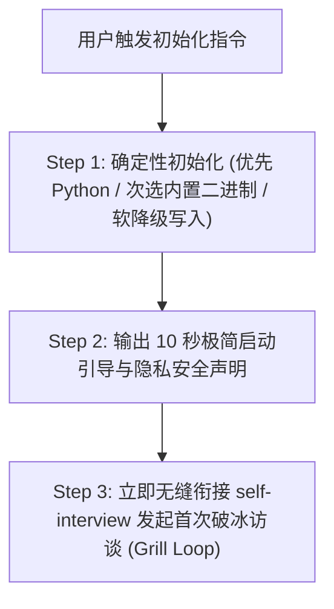

# `self-init`：系统冷启动与骨架初始化技能

本技能专门解决新用户在一个**完全空白的仓库**中首次建档时的“冷启动”问题。通过内置跨平台编译的 Golang 二进制工具，**1 秒内 100% 确定性**准备好所有目录、规范文档与空白模板，杜绝大模型漏写文件，并无缝引导新用户完成第一次建档访谈。

---

## 一、触发条件

- 新用户首次与 AI 对话，例如：“开始建立我的个人系统”、“初始化”、“我是新用户”、“/init”等；
- 仓库中尚不存在 `context/05_当前理解模型.md` 或 `AGENTS.md` 时；
- 用户明确要求重置或初始化新的空白认知知识库时。

---

## 二、初始化标准执行步骤（SOP）



---

### Step 1：执行确定性初始化（执行优先级阶梯）

为确保在不同平台（PC、服务器、Android 手机如 dsh-go 等）均能 100% 稳定运行，按以下优先级执行初始化：

#### 优先级 1（首选）：Python 脚本执行
若当前宿主环境具备 `python3` 或 `python`（如 Android 手机 Termux、已安装 Python 环境的各种 Agent 终端），**优先直接执行纯标准库 Python 脚本**，零编译依赖、免除架构与可执行权限限制：
```bash
python3 .agents/skills/self-init/scripts/init.py
# 或若系统中命令为 python：
python .agents/skills/self-init/scripts/init.py
```

#### 优先级 2：调用预编译原生二进制
若无 Python 环境但处于支持运行原生二进制的终端，AI 检查当前操作系统与架构，调用对应二进制程序：
- **Android 手机 (arm64-v8a)**: `.agents/skills/self-init/bin/init-android-arm64`
- **Linux (aarch64 / Termux)**: `.agents/skills/self-init/bin/init-linux-arm64`
- **Linux (x86_64)**: `.agents/skills/self-init/bin/init-linux-amd64`
- **macOS Apple Silicon (M系列)**: `.agents/skills/self-init/bin/init-darwin-arm64`
- **macOS Intel**: `.agents/skills/self-init/bin/init-darwin-amd64`
- **Windows**: `.agents/skills/self-init/bin/init-windows-amd64.exe`

#### 优先级 3：纯模板文件写入（软降级兜底）
若受限沙盒环境完全禁止执行任何外部脚本或二进制程序，AI 直接读取 `.agents/skills/self-init/templates/` 目录下的纯净模板并替换当前日期 `{{DATE}}` 执行文件写入。

> **执行效果**：1 秒内自动完成目录创建、当前日期替换与 12 个关键骨架文件的生成：
> 1. `AGENTS.md`（项目宪法元规则与四层隔离定义）
> 2. `README.md`
> 3. `CHANGELOG.md`
> 4. `.gitignore`（过滤系统杂质与临时隐私泄漏）
> 5. `docs/00_存储与内容格式规范.md`
> 6. `docs/01_原始自述.md`
> 7. `docs/02_完整自述（整合版）.md`
> 8. `docs/03_事实、人物与时间线.md`
> 9. `docs/04_AI分析与认知演化.md`
> 10. `context/05_当前理解模型.md`
> 11. `context/06_AI_CONTEXT.md`
> 12. `docs/基线认知测试题组.md`（4大维度、12道情境测试题，支持随时查阅或自填）

---

### Step 2：向新用户展示极简引导与隐私安全声明

初始化完成后，向用户发送简洁、温暖、无压力的引导信息：

> 🎉 **个人知识系统初始化完成！**
> 
> 这是一个忠实记录“你如何逐渐理解自己”的动态认知数据库。我不会替你定义身份，不套用固定心理学标签，也不会做病理诊断。
> 
> 🔐 **隐私与安全提醒**：
> 1. 本系统包含你高度隐私的身心感受与真实经历。若托管到 GitHub 等平台，请务必设为 **Private（私有仓库）**。
> 2. 建议在当前 AI 工具设置中关闭“允许使用数据进行模型训练”。
> 
> 📋 **初始全景认知基线题组已就绪**：
> 已在 `docs/基线认知测试题组.md` 为你准备好涵盖生活支点、人际防御、身心应激与未解之谜的 12 道测试题。你可以随时查看自填，也可以由我直接向你发起访谈。
> 
> 💡 **日常极简用法（只有三件事）**：
> - **不知道聊什么**：输入“你采访我吧”或“深挖盲区”（调用持续下钻的 `self-interview` Grill Loop）；
> - **想倾诉或复盘**：直接找我聊现实事件、人际关系或情绪波动（调用 `self-explore`）；
> - **聊够了想保存**：输入“归档”（调用 `self-archive` 自动增量写入知识库）。

---

### Step 3：无缝激活 `self-interview` 破冰模式

在输出上述引导后，**不要停顿等待用户再次输入**，而是紧接着调用 [`self-interview`](../self-interview/SKILL.md) 抛出基于题组【维度一：现实支点与能量代谢】的第 1 组基线访谈问题，开启系统的初次建档。
