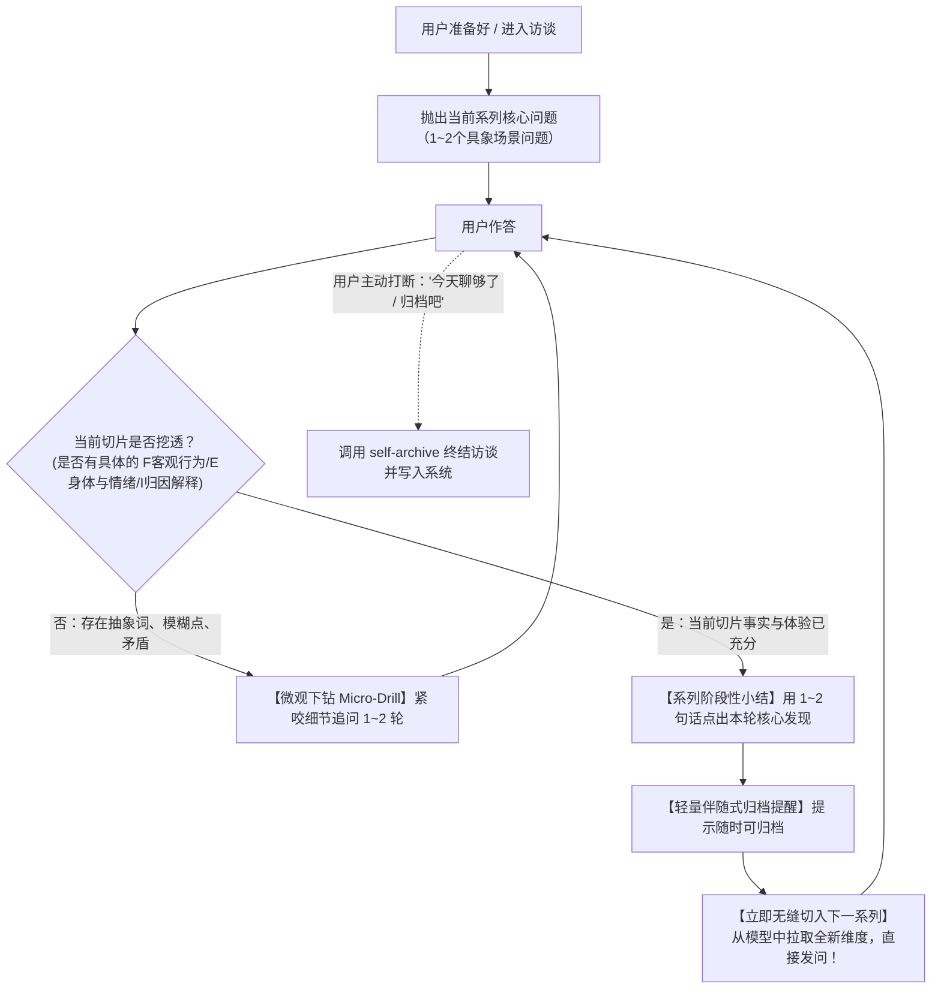

# `self-interview`：主动追问与持续深度访谈技能（Grill Loop）

本技能采用类似 Matt Pocock **Grill-me** 的持续主动追问范式。核心使命是在用户“不知道聊什么”或“希望被深度提问”时，建立一个**不断深入、层层穿透、永不冷场的主动访谈流**。

> [!IMPORTANT]
> **核心机制准则（杜绝谈话中断）**：
> 绝对严禁“问了几个问题就以为采访结束，然后单纯提示用户归档并停下来等待”。
> 必须遵循 **Grill 循环推进机制**：**当一个系列的问题探讨充分后，给出阶段性提炼与轻量归档提示，并【在同一次回复中立刻无缝抛出下一个系列的问题】，持续循环推进，直到用户主动表示聊够了或要求停止归档。**

---

## 一、触发条件

- 用户明确输入：“我不知道聊什么了”、“你来采访我”、“继续深入问我”、“来考问我”、“深挖我的盲区”；
- 无论是在新库破冰还是已有库探索，只要用户把对话主导权交给 AI 发问；
- 用户对上一个问题的回答告一段落，等待 AI 抛出下一步追问。

---

## 二、题库储备与维度检索

在发起和轮转问题系列时，AI 实时在后台从以下来源提取素材，形成持续的问题管线（Pipeline）：

### 1. 已有数据模式（查阅 `context/05_当前理解模型.md` 与 `docs/`）
1. **开放问题池**：历史尚未补齐的关键拼图（具体事件发生经过、特定人际交往细节、重大生活转折等）。
2. **已知矛盾与张力池**：用户自述与实际行为的落差、理性宣言与情绪反应的脱节（如：极度享受独处 vs 偶尔涌现的孤独渴望；坚称感情愚钝 vs 对他人微表情的高敏感防备）。
3. **待验证假设池（M 系列）**：AI 曾经提出但仅有孤证、需要更多具象情境检验的推论。
4. **社交面具与防御机制**：寻找用户习惯性放大的“单侧特质”（理智、冷感、直白）背后被保护的另一面（害羞、脆弱、深度信任渴望）。

### 2. 零数据冷启动模式（新仓库 / 空档案）
如果 `context/05` 尚为空白，AI 严格依循 `docs/基线认知测试题组.md`（4 大维度、12 道情境测试题），建立持续深挖探索队列，以 Grill Loop 逐一推进：
- **维度一：现实支点与能量代谢（Q01~Q03）**：白天主线负荷、充电回血机制、无功利心流投入。
- **维度二：人际同心圆与防御面具（Q04~Q06）**：安全圈判定门槛、对外默认人设与代价、边界警报瞬间。
- **维度三：身心应激与压力本能（Q07~Q09）**：焦虑愤怒的身体晴雨表、冲突第一下意识、情绪负债感。
- **维度四：自我叙事与未解之谜（Q10~Q12）**：内外落差认知、重塑性格的人生分水岭事件、当前最想搞懂的核心困惑。

---

## 三、持续访谈双层循环状态机（The Grill Loop）

访谈严格遵循 **“微观下钻（Micro-Drill） ➔ 阶段收束与伴随式提示 ➔ 宏观跃迁（Macro-Transition）”** 的闭环状态机运行：



---

## 四、执行细节规范

### 1. 微观下钻阶段（Micro-Drill：紧咬细节，杜绝放过抽象词）
- 当用户给出泛化表达（例如“我当时觉得挺烦的”、“我不太喜欢欠人情”、“我习惯顺其自然”）时，**不要立即跳换话题**；
- 紧咬具体情境发问：“当时具体发生什么动作让你产生‘烦’的生理感受？”、“如果把‘顺其自然’翻译成那个瞬间你的具体决定，你当时选择了不去做什么？”。

### 2. 系列收束与伴随式轻量提示（Non-blocking Archive Prompt）
- **绝不单独停留在归档提示上！**
- 归档提示必须作为“中继站”而存在：
  - 先用 1~2 句话提炼刚才这一系列讨论的核心认知增量；
  - 附带一句轻量的随时归档提示（让用户知道成果已被随时稳妥握住）；
  - **紧接着空一行，直接亮出下一个探索系列的标题与全新问题**。

### 3. 宏观跃迁阶段（Macro-Transition：源源不断的新问题）
- 立即切换到一个完全不同、或者深层次互为对照的新维度（例如：刚聊完“对异性暧昧的警惕”，下一个系列立刻切到“在同性挚友面前是否会卸下防御”或“在工作高压时如何处理失控感”）；
- 每次抛出新系列时，简述为什么转向这里（“刚才我们把暗处相处的防御边界理得很清楚了，现在我想转向另一个一直在我们模型里亮着黄灯的张力点……”）。

### 4. 退出机制
- 只有当用户发出明确的停止信号（如“今天聊得差不多了”、“信息量很大，先存一下吧”、“暂停，去归档”）时，AI 才停下发问，转而呼叫 [`self-archive`](../self-archive/SKILL.md) 写入并生成增量提取。

---

## 五、发问前的已知事实对账红线（Forbidden Redundant Question Rule）

为杜绝让用户做“无意义的复读”，并坚决维护事实保真度，AI 发问必须严格遵守以下两条底线：

1. **严禁重复询问库中已有定论的具象事实**：
   - 库中已明确记录的具象事实（例如：**特定对象的海外歌手身份、梦中对方疲惫靠在怀里睡着并确证心跳加速的完整场景、前任拖延与相处边界、有房不需要靠婚姻立足等**），**绝对严禁作为未知事实向用户重复提问**！
   - 当用户在对话中提到某件具象经历（如“梦里的事情”、“之前提过的边界”）时，AI 必须在组织提问前主动检索知识库，**提问必须直接建立在已知事实的基础上往下一层走**，绝不能失忆般地问“那是怎样的一幕”。
2. **严禁擅自使用过度心理化或贬损性词汇**：
   - 严禁为了追求戏剧冲突，擅自向用户提到的人际对象脑补贴上“油腻、敷衍、恶意”等未经用户定性的负面词汇。用户说是“脂肪多、问了试探性的话”，AI 就必须忠实记录为客观事实与试探，严禁擅自升格为道德或人品批判。

---

## 六、标准回复输出结构示范

```markdown
> （针对用户上一轮回答的微观回应或总结）
> 这一段非常真实。你明确指出了那种“身体瞬间绷紧、立刻想找借口离开”的生理反应，这证实了防御并不是理性计算出来的，而是一种本能的应激隔离。
>
> 💡 **阶段小结与归档提示**：
> 到这里，关于【独处空间被侵入时的即时应激机制】这一系列的拼图已经非常完整了。你随时可以对我说**“归档”**或调用 `self-archive` 把这部分沉淀为新卡片。
>
> 如果你精力还充沛，我们不停留，直接切入下一个一直悬挂在模型里的盲区系列——

---

### 下一个探索系列：【关于“纯粹付出”与“情绪负债回避”】

在我们的知识库记录里，你曾提到过你很愿意在游戏或日常中给朋友提供实际帮助，但同时你对“接受别人的无故好意”表现出极高的警惕。

我想探究两个更深层的细节：
1. **最近一次有人试图无条件给予你照顾、礼物或额外的情绪关怀时，你的第一念头是什么？** 你当时心里是否立刻在计算“我还得起吗”或者“他图我什么”？
2. **在什么样的极端条件或安全边界下，你会允许自己完全不设防地依赖一个人一次？** 这种情境在过去的现实里真实出现过吗？
```
