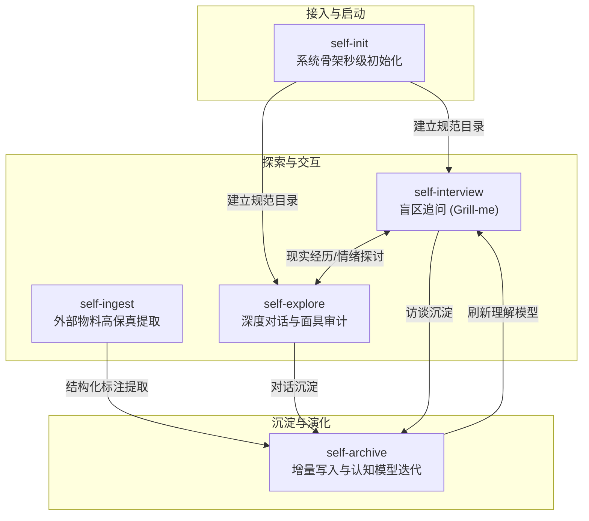

# `self-skills`

> **长期个人认知演化与深度自我理解 Agent 技能库**  
> *An Agentic Framework for Continuous Self-Understanding, Cognitive Modeling, and Life Archiving.*

[](LICENSE)
[-brightgreen.svg)]()
[]()

---

## 一、为什么需要 self-skills？

市面上的大多数 AI 助理被训练来“讨好用户”或“给出即时安慰”；而流行的人格测试（MBTI、星座）则热衷于用固定标签将复杂的活人装入扁平的盒子里。

**`self-skills` 走了一条截然相反的路**：
它是一套遵循严格**信息隔离宪法**的 Agent 专属技能库。目标**不是**心理诊断，**不是**生成人格标签，而是协助你建立一个**随着岁月持续演化、可被反思验证与修正的个人认知数据库**，忠实记录“一个人如何逐渐理解自己”。

- 🪞 **AI 的角色**：分析整理工具、模式发现者与认知辅助镜子，绝非人生裁判或身份定义者。
- 🚫 **绝对禁区**：
  1. 严禁替用户决定真实想法，严禁用单一理论模型套用解释所有行为；
  2. 严禁将推测包装成事实，严禁用现成病理化/心理学标签定义用户；
  3. 严禁为了追求逻辑一致而抹除内在矛盾，严禁为了迎合或安慰而回避现实张力。

---

## 二、不可违背的核心元原则（宪法）

1. **信息四层级严格隔离（严格禁止混淆升级）**：
   - **Level 1 原始事实 `[F]`**：明确发生的客观物理事件与行为（必须有原始自述依据）。
   - **Level 2 主观体验 `[E]`**：身体感受、情绪波动、即时冲动（保留原话词汇，不替换为学术术语）。
   - **Level 3 主观解释 `[I]`**：用户对自身动机、性格的归因与自我评价（作为主观理解记录，不直接等同于客观事实）。
   - **Level 4 AI 假设 `[M/A]`**：AI 观察到的模式、认知假设与推演（必须明确其边界与需要何种新事实推翻）。
2. **原始材料最高保真（只增不删）**：
   - 所有的原始经历只增不删，不篡改历史。对过往认知的更新全部沉淀在分析层与模型层。
3. **真实性与面具审计红线（Reality Check）**：
   - **事实真实 ≠ 叙述完整**：排查“通过只讲真实事实来达成误导目的”的自我叙事；
   - **单侧特质放大排查**：当极力呈现某一真实特质时，审计其是否在掩盖被保护的另一面，探究面具带来的外部便利与内部防御代价；
   - **保留内在矛盾**：当言行脱节或理性与情绪冲突时，完整保留张力，绝不强行抚平。

---

## 三、技能全景与流转架构



### 核心技能清册

| 技能 | 对应指令/意图 | 核心职责 |
| :--- | :--- | :--- |
| **`self-init`** | `开始建立我的系统` / `初始化` | 确定性生成规范文档骨架。提供**Python脚本（全平台优先）**与**跨平台Go原生二进制**（包含 Android arm64-v8a），1 秒内完成冷启动与基线题组导入。 |
| **`self-interview`** | `你来采访我` / `挖掘我的盲区` | **Grill Loop 深度访谈流**。查阅认知模型中的开放问题、张力与待验证假设，持续主动深挖；与已知事实实时对账，无限穿透直至叫停。 |
| **`self-explore`** | `探讨某件事` / `倾诉烦恼` | 深度对话与叙述解构。执行 Level 1~4 严格拆解，识别“真话误导”与社交面具，温和而直接地指出隐藏变量与内在矛盾，拒绝廉价安慰。 |
| **`self-ingest`** | `导入这篇日记/聊天记录` | 外部长文本导入。赋予唯一自述编号（`U-xxx`），按 F/E/I 标注四层信息并执行历史事实对账审计，输出结构化草稿。 |
| **`self-archive`** | `保存这次对话` / `归档记录` | 本地归档与模型迭代。将会话存入 `source/chats/`，生成增量提取卡片，更新 `docs/` 总账，同步刷新全局理解模型并在 `CHANGELOG.md` 登记版本。 |

---

## 四、安装与使用

### 1. 移动端使用（如 [dsh-go](https://github.com/ccch1mneyyy/dsh-go) / Termux / 手机终端）

本项目对 **Android 手机（arm64-v8a / aarch64）** 提供了原生级别的适配支持：

```bash
# 克隆仓库
git clone https://github.com/OldBeLight/self-skills.git

# 方式 A（首选）：直接使用 Python 脚本初始化你的私人数据目录
python3 self-skills/.agents/skills/self-init/scripts/init.py --target ~/my-private-knowledge

# 方式 B（Android 原生二进制）：
cd self-skills/.agents/skills/self-init
chmod +x bin/init-android-arm64
./bin/init-android-arm64 --target ~/my-private-knowledge
```

> **移动端优势**：
> - `scripts/init.py` 纯使用 Python 3 标准库，零外部依赖，免除任何编译与架构兼容烦恼；
> - `init-android-arm64` 原生适配 Android Bionic 与 PIE 执行保护机制。

---

### 2. 桌面端 AI 编程工具接入（Antigravity / Claude Code / Cursor / Windsurf 等）

#### 方案 A：直接作为子模块或拷贝到个人私人仓库
1. 创建你自己的私人仓库（如 `my-life`，**务必设为 Private**）；
2. 将本仓库的 `.agents/skills` 目录拷贝至你项目的根目录下：
   ```bash
   cp -R self-skills/.agents /path/to/your-private-repo/
   cp self-skills/AGENTS.md /path/to/your-private-repo/
   ```
3. 在 AI 对话窗口中发送：“**开始建立我的个人认知档案**” 即可触发初始化引导！

#### 方案 B：使用开箱即用的 Starter-Kit 脚手架
本仓库内自带零隐私的脚手架目录 [`starter-kit/`](starter-kit/)：
```bash
cp -R self-skills/starter-kit/* /path/to/your-private-repo/
```

---

## 五、生成的数据结构概览

通过 `self-init` 初始化后的个人知识库具备三层清晰的隔离架构：

```text
my-knowledge/
├── AGENTS.md                          # 宪法/元原则（常驻 Prompt）
├── README.md                          # 仓库导航
├── CHANGELOG.md                       # 认知演化与模型变更日志
│
├── source/                            # 【Level 1 最高保真原始层（只增不删）】
│   ├── chats/                         # 对话归档切片 (YYYY-MM-DD_主题.md)
│   └── documents/                     # 导入的日记、随笔、外部记录
│
├── docs/                              # 【Level 2~4 结构化认知层】
│   ├── 00_存储与内容格式规范.md         # 字段与 ID 规范
│   ├── 01_原始自述.md                  # 全量原话总账 (带 U 编号)
│   ├── 02_完整自述（整合版）.md         # 第一人称连贯自我画像长卷
│   ├── 03_事实、人物与时间线.md         # 事实 (R) 与人物 (P) 总账
│   ├── 04_AI分析与认知演化.md          # 历史推演与假设演化史
│   └── increments/                    # 每次对话的结构化提取卡片
│
├── context/                           # 【AI 快速读取工作面】
│   ├── 05_当前理解模型.md              # 稳定观察、当前假设、矛盾与开放问题
│   └── 06_AI_CONTEXT.md               # 导出给手机端/无工具端使用的上下文精简副本
│
└── .agents/skills/                    # 驱动系统运转的技能集
```

---

## 六、🔐 隐私与安全红线声明

> [!CAUTION]
> **关于数据隐私的郑重提醒**：
> 1. **务必使用私有仓库（Private Repo）**：你的个人自述记录包含极其敏感的心流体验、真实人际互动与脆弱面，一旦推送到公共仓库将导致不可挽回的隐私泄漏！
> 2. **关闭模型训练授权**：在使用的 AI 工具设置中，建议关闭「允许使用我的对话数据训练公共模型」（Prevent Training）选项；
> 3. **端侧优先**：尽量结合端侧模型或安全可控的 API 使用。

---

## 七、许可证

本项目采用 [MIT License](LICENSE) 开源许可协议。欢迎自由分发与定制。
