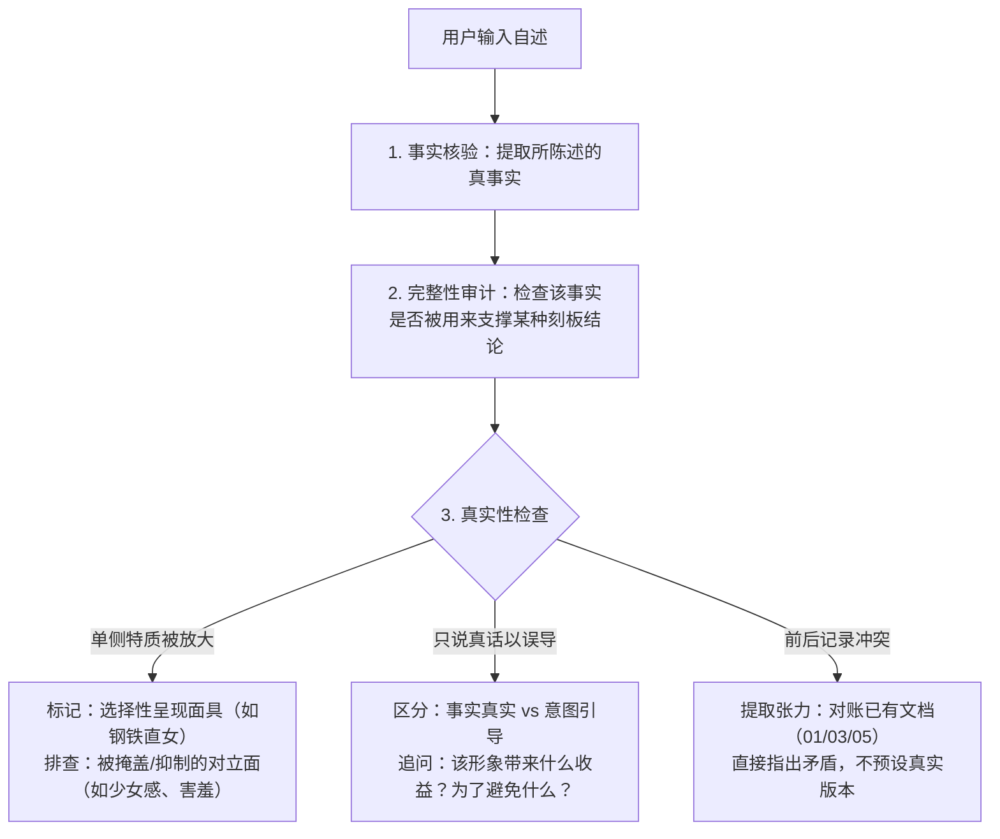

# 00 存储与内容格式规范

> 版本：v1.0  
> 建立日期：2026-10-15  
> 适用范围：本项目全体文档存储、结构化提取与 Skills（特别是 self-archive、self-ingest、self-explore、self-interview）执行标准。

---

## 一、目录分层与职责边界

系统遵循三层数据分级与独立的技能扩展层，确保历史可追溯、增量可扩展、AI 读取高效：

```text
myself/
├── AGENTS.md                          # 宪法/元原则（常驻 Prompt：认知原则、信息分级定义、伦理与边界）
├── README.md                          # 仓库导航与文档索引
├── CHANGELOG.md                       # 认知演化与核心模型变更日志
│
├── source/                            # 【Level 1 最高保真原始层（只增不删）】
│   ├── 原始聊天记录.md                 # v1 历史对话基线（90组发言，保留行号与既有超链接）
│   ├── chats/                         # 对话归档切片（如 YYYY-MM-DD_主题.md）
│   └── documents/                     # 用户输入的外部资料、日记、备忘录
│
├── docs/                              # 【Level 2~4 结构化认知与索引层】
│   ├── 00_存储与内容格式规范.md         # [本文档] 存储规范、ID体系与审计标准
│   ├── 01_原始自述.md                  # 【全量原话总账】逐字原话归档，持续追加所有 U 编号发言
│   ├── 02_完整自述（整合版）.md         # 【第一人称动态传记】连贯自我画像长卷，随认知演化持续更新
│   ├── 03_事实、人物与时间线.md         # 事实、人物与时间线总账（T01~T17...）
│   ├── 04_AI分析与认知演化.md          # 历史推演、AI假设修正与演化史（A-H/A-E...）
│   └── increments/                    # 每次归档生成的单次增量提取卡片
│       └── YYYY-MM-DD_提取记录.md      # 会话或文档的结构化提取快照
│
├── context/                           # 【AI 快速读取工作面】
│   ├── 05_当前理解模型.md              # 当前全局理解模型（稳定观察、假设、矛盾、开放问题）
│   └── 06_AI_CONTEXT.md               # 导出给 ChatGPT Library / 移动端使用的精简副本
│
└── .agents/
    └── skills/                        # 【技能库】按需加载的工作流规范（SKILL.md）
        ├── self-interview/            # 主动追问/盲区访谈技能
        ├── self-explore/              # 深度对话/叙述解构技能
        ├── self-ingest/               # 批量文档结构化解析技能
        └── self-archive/              # 本地归档与写入同步技能
```

---

## 二、ID 命名空间规范

为避免随着时间推移产生编号混乱或跨文件冲突，所有条目采用统一的命名空间：

| 实体类别 | 标识符前缀 | 格式示例 | 说明与适用范围 |
| :--- | :--- | :--- | :--- |
| **原始会话切片** | `CHAT-` | `CHAT-20261015-01` | `source/chats/` 下的具体会话归档文件 |
| **外部原始文档** | `DOC-` | `DOC-20261015-01` | `source/documents/` 下的用户输入文本文件 |
| **用户发言/自述** | `U-` | 历史：`U001`~`U090`<br>增量：`U-20261015-01` | 用户直接表达的原话摘录，保留逐字文本 |
| **时间线事件** | `T-` | 历史：`T01`~`T17`<br>增量：`T-20261015-01` | 现实发生或自述经历的时间点/事件 |
| **客观事实** | `F-` | `F-20261015-01` (或随T) | 经陈述且未推翻的背景事实（如年龄、职业等） |
| **主观体验** | `E-` | `E-20261015-01` (或随T) | 情绪反应、身体感觉、主观心理体验 |
| **用户主观解释** | `I-` | `I-20261015-01` (或随T) | 用户对自己或他人行为、动机的归因与评价 |
| **疑问与意向** | `Q-` | `Q-20261015-01` (或随T) | 尚未发生或尚未确定的假设、意向、开放问题 |
| **AI 解释模型** | `M-` | `M01`~`M05`（全局递增） | AI 提出的结构化模式解释与待验证假设 |
| **历史 AI 分析** | `A-H` / `A-E` | `A-H01...` / `A-E01...` | AI 分析记录与演化修正记录 |

---

## 三、文件格式与元数据规范

### 1. 原始文件头部 YAML Frontmatter
所有存入 `source/chats/` 与 `source/documents/` 的文件，必须包含以下元数据：

```yaml
---
source_id: CHAT-20261015-01
date: 2026-10-15
type: chat_session # 或 document_import
topic: "主题简述"
participants: [user, AI]
entry_count: 8
tags: [亲密关系, 社交面具, 自我防御]
---
```

### 2. 信息四层级标准 Markdown 表现语法（GitHub Alert）
在整理和分析文档中，强制使用以下语义语法区分信息级别，防止推测混同于事实：

```markdown
> [!NOTE] **Level 1：原始事实 [F]**
> 用户陈述明确发生的事情、客观行为或背景条件。必须有具体的 U 编号支撑。

> [!TIP] **Level 2：用户主观体验 [E]**
> 用户对身体感觉、情绪、内隐心理体验的描述。严格保留用户原话词汇，不替换为学术诊断词。

> [!IMPORTANT] **Level 3：用户主观解释 [I]**
> 用户对自身或他人动机、因果关系的归因。记录为“用户的理解”，不直接当成客观事实。

> [!WARNING] **Level 4：AI 待验证假设 [M]**
> AI 识别出的模式假设、潜在机制与理论解释。必须明确其边界与需要何种新事实推翻。
```

### 3. 理解模型卡片格式（`context/05_当前理解模型.md`）
在当前模型中，每个观察或假设必须符合如下结构：

```markdown
### M0x：【假设简述】
- **当前状态**：[较稳定观察 | 待验证假设 | 阶段性结论]
- **支持证据**：`U-xxxx`、`T-xxxx`
- **潜在张力 / 矛盾**：指出与其不一致的自述或现实行为
- **隐藏变量与审查点**：用户是否存在选择性呈现？是否存在未考虑的情境？
- **最近更新与变更依据**：YYYY-MM-DD（对应 CHANGELOG 条目）
```

---

## 四、真实性审计与输入处理规范（Reality Check 标准）

本项目的一大核心挑战是：**“面对 AI 也存在无意识隐藏，且非常懂得通过‘只讲真话’来完成误导或维持面具”**。

在所有处理用户 Input 的技能（`self-interview`、`self-explore`、`self-ingest`）中，必须强制执行以下审计流程：



### 审查核心原则：
1. **“事实真实”不等于“叙述完整”**：用户讲出的每一句话都可以是真事（如不爱看黄片、分手干脆），但组合起来可能刻意导向一个偏颇的人格定性（如“不懂感情和性”）。
2. **识别“单侧放大”与“面具收益”**：
   - 关注用户放大了哪种特质？
   - 探寻被掩盖的另一面是什么（如因害羞而不愿公开的柔软、浪漫、欲望）？
   - 这种面具为用户带来了什么便利（避免被性化、减少窥探、避免暧昧、享受掌控感）？
3. **严格对账历史记录**：
   - 新输入与旧自述（`docs/01`、`docs/03`）对照；
   - 用户的自我标签（如“感情傻子”“冷漠”）与其实际感受敏锐度对照；
   - 意向（如“愿意无条件给予”）与具体现实操作边界对照。
4. **不作道德指责，也不轻信表层**：
   - 选择性呈现是常见的自我保护策略，不是恶意的欺骗，不需要道德评判；
   - 但 AI 绝不能顺着人设直接相信，必须指出张力，温和且直接地把被隐藏的另一面带入分析。

---

## 五、增量归档流程标准（`self-archive` 执行 SOP）

当触发 `self-archive` 时，按以下顺序落盘：

1. **源数据切片**：
   - 将当前会话整理为标准格式，写入 `source/chats/YYYY-MM-DD_<主题>.md`，生成唯一 `source_id`。
2. **提取增量卡片**：
   - 提取新自述（赋予 `U-YYYYMMDD-xx` 编号）与事件（`T-YYYYMMDD-xx` 编号），按 Level 1~4 归类；
   - 保存至 `docs/increments/YYYY-MM-DD_提取记录.md`。
3. **同步核心总账与模型**：
   - **更新 `docs/01_原始自述.md`**：将本次提取的 `U-` 原话按主题（或追加新主题章节）同步存入全量总账，永续保留原话；
   - **更新 `docs/02_完整自述（整合版）.md`**：若产生新经历、人设或认知演化，以第一人称（“我”）视角将其有机融入叙事长卷；
   - **更新 `docs/03_事实、人物与时间线.md`**：追加新事件与时间线（`T-` 编号）；
   - **更新 `docs/04_AI分析与认知演化.md`**：若修正、推翻或提出新假设，记录演化依据；
   - **更新 `context/05_当前理解模型.md`**：评估并修订稳定观察、假设、矛盾、开放问题；
   - **同步精简版 `context/06_AI_CONTEXT.md`**：保持跨平台副本同步。
4. **记录 CHANGELOG**：
   - 在 `CHANGELOG.md` 中记录本次归档引起的认知模型演化，注明版本理由。
