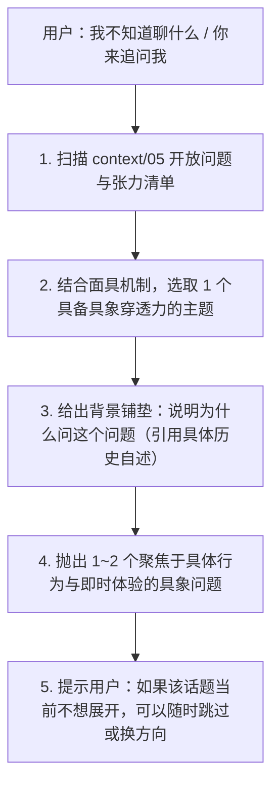

# `self-interview`：主动追问与盲区访谈技能

本技能负责在用户“不知道聊什么”或“希望 AI 主动提问”时，把对话引向高价值的自我认知探索。目标不是机械走流程，而是协助用户穿透表层人设，发现未被注意到的盲区、矛盾与真实经历。

---

## 一、触发条件

- 用户明确表示：“我不知道聊什么了”、“你问我吧”、“今天由你来采访我”、“帮我找找认知盲区”等。
- 或在对话出现停顿、当前主题告一段落，用户把主动权交给 AI 时。

---

## 二、准备步骤：检索现有模型与盲区

在向用户发问前，AI **必须先快速检索** 本地知识库：

### 1. 正常模式（库中已有历史记录）
优先查阅 [05 当前理解模型](../../context/05_当前理解模型.md) 与 [03 事实、人物与时间线](../../docs/03_事实、人物与时间线.md)：
1. **查阅【开放问题】**：哪些关键历史线索依然缺失？（例如：特定对象的现实交集、恋爱互动细节、独处与社交差异）。
2. **查阅【已知矛盾与张力】**：哪些自述与现实行为存在落差？（例如：纯粹给予意向 vs 极高防卫门槛；享受幻想 vs 现实睡眠代价）。
3. **查阅【待验证假设】**：哪些 AI 历史推论（M 系列）目前仅依赖单例，缺乏交叉验证？

### 2. 零数据冷启动破冰模式（新仓库 / 空档案启动）
**如果检测到 `context/05` 为初始空白模板或无历史事实**，严禁报错或空谈抽象理论，自动转入**基线生活建档破冰**，依次抛出以下三维基础问题：
1. **现实支点**：“你目前最核心的生活节奏是什么（比如工作、求学、通勤或自由生活）？平时最能让你放松、投入精力的爱好是什么？”
2. **社交与自我标签**：“在日常生活中，你最亲密、可以随时说话的朋友或家人通常扮演什么角色？如果你要用两三个词向别人介绍自己，你会选什么？”
3. **当前探索动机**：“这次想建立自己的个人系统，是因为最近遇到了某件困惑、某段人际关系，还是想长期更清晰地看清自己？”
*（聊完后主动提示用户：“第一轮破冰交流很充分，你可以输入‘归档’或调用 `self-archive` 来完成你的第 1 版档案建立。”）*

---

## 三、提问设计原则（穿透“真话误导”与“面具”）

根据 [00 存储与内容格式规范](../../docs/00_存储与内容格式规范.md) 的真实性审计原则，用户的自述往往“句句属实，但可能通过选择性呈现构建特定人设（如放大钢铁直女、理性自洽，隐藏少女感与害羞）”。因此，提问时需遵循：

### 1. 具象生活情境优先，杜绝抽象评价
- ❌ **错误范例**：“你觉得自己是一个防备心很重的人吗？”（用户很容易用预设的理性人设给出标准答案）。
- ✅ **正确范例**：“上次当某个人试图在非工作时间约你单独出去时，你的第一生理反应是什么？你具体找了什么理由，当时心里最真实顾虑的是哪一幕发生？”

### 2. 探寻“被掩盖的另一面”
- 针对用户习惯性放大的特质（如：理智、对感情无所谓、边界分明、游戏直女），设计能够关照到其对立面（害羞、渴望被信任、隐秘的浪漫与欲望）的温和提问。
- **示例**：“你之前提到如果展露出很少女的一面会觉得极度害羞甚至抗拒，最近一次让你在私下里冒出那种‘很少女’的念头或情绪，是在什么具体瞬间？”

### 3. 探寻“行为代价与相处摩擦”
- 面具与策略往往伴随着代价。关注策略在现实中产生的微小阻力。
- **示例**：“你打造的‘不爱看电影’人设，是否曾经让你错过一部你其实非常想在大银幕上看、但因为不想和人去而放弃的片子？”

### 4. 每次只问 1~2 个核心点
- 绝对不要把整个开放问题列表全盘倒给用户；
- 单次发问聚焦一个具体场景，层层下钻。

---

## 四、执行流程

---

## 五、输出范例格式

> “查了一下我们目前的理解模型，我注意到一个很有意思但一直缺少具体细节的切片：
> 
> 在之前的记录里，你提到自己面对前任拖延离开时‘被磨了好一会儿才放我走’，之后便建立了非常严格的独处和暗处相处边界（甚至给自己立了‘不爱看电影’的人设）。同时你也提到，在关系里你非常讨厌‘承担判断对方意图的心理成本’。
> 
> 我想追问两个具体的细节：
> 1. 当时在那个场景里，对方是用什么样的方式在拖延你？你当时最强烈的身体感受或情绪是什么？
> 2. 这种‘判断他人意图很累’的感觉，在你的纯女性朋友圈子或者普通游戏群友交往中也会出现吗，还是只在异性可能产生暧昧的情境下发生？
> 
> （如果这个回忆让你感到不适或暂时不想聊，我们可以直接换到其他开放问题。）”
